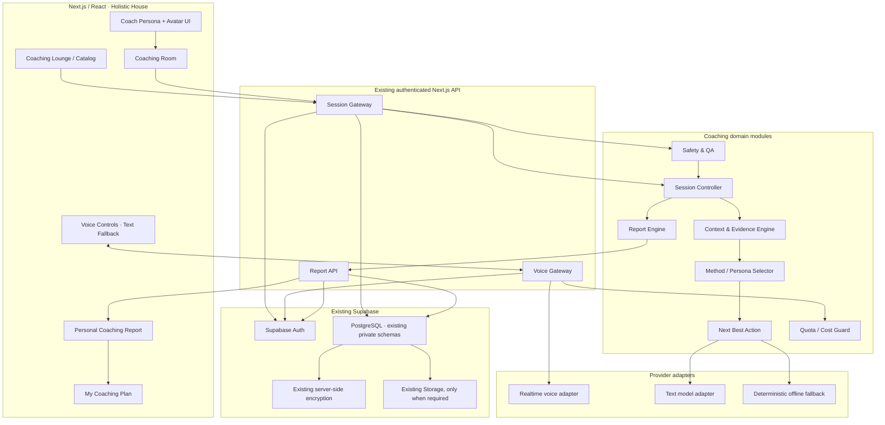
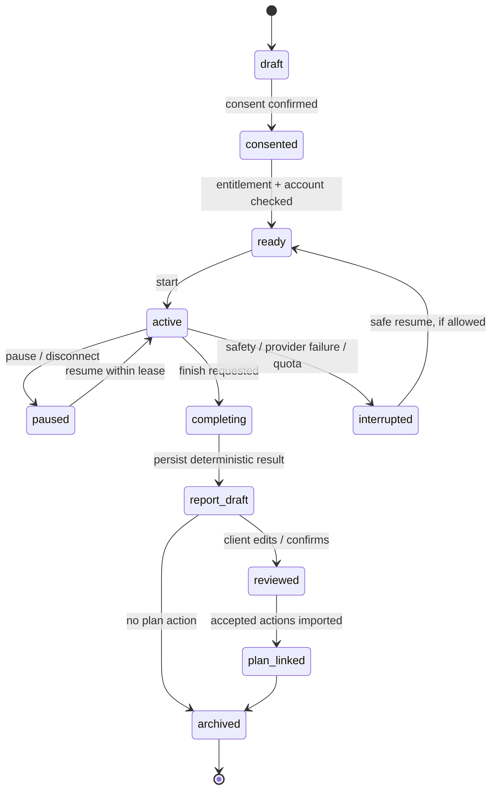

# Holistic House Coaching Platform — Architecture v1

**Статус:** архитектурный baseline / implementation in progress  
**Дата:** 2026-11-09  
**Ветка-источник:** `codex/public-book-library`  
**Связанные работы:** #4018 (umbrella), #3980 (20-minute GROW), #4014 (Session Report v2 / My Coaching Plan)

## 1. Архитектурное решение

Coaching — самостоятельный bounded context внутри существующего Holistic House, но не отдельный продукт и не отдельная инфраструктура.

Остаются едиными:
- Next.js / React приложение и публичная навигация;
- Supabase Auth, account identity и текущая проверка активного аккаунта;
- единственная PostgreSQL база Holistic House;
- существующее backend-шифрование и account-scoped private storage;
- текущие CRM, кабинет, сервисы и My Coaching Plan;
- действующий каталог утверждённых методик, локализаций, вопросов и сессий.

Новые модули разделяют ответственность внутри существующего приложения. Они не создают второй session runner, второй client cabinet или параллельный список задач.

## 2. Целевая схема компонентов

## 3. Границы и ответственность

### 3.1 Frontend — Coaching Room
- Показывает выбранного коуча, его фотографию/аватар, роль, краткое описание и фокус.
- Поддерживает текстовый и голосовой режимы в одном sessionId.
- Даёт Start / Pause / Resume / Finish, mute, переключение текста/голоса, повтор последней реплики, явное завершение.
- Отображает стадии сессии и короткое описание текущей стадии, а не внутреннее состояние модели.
- На мобильном экране основной сценарий помещается в один viewport; transcript/notes открываются отдельно.
- Не содержит provider secrets, правил доступа или авторитетных решений по оплате/лимитам.

### 3.2 Session Gateway
Единая серверная точка для всех операций сессии:
- подтверждает Supabase user и активный account;
- проверяет entitlement, consent, возрастное подтверждение для соответствующего опубликованного направления;
- создаёт или возобновляет session, фиксирует sessionId и revision;
- валидирует действия и версии схемы;
- ограничивает частоту запросов, параллельные сессии, длительность и бюджет;
- обеспечивает идемпотентность команд finish/save/import;
- переводит сессию в terminal state и закрывает voice provider;
- не принимает accountId / ownerId из тела запроса как источник полномочий.

Существующие API и `lib/app/personal-coaching.js` — базовый контракт для сохранённых структурированных сессий. Их нельзя переписывать без совместимого адаптера и регрессионных тестов.

### 3.3 Coaching Brain
Оркестратор, а не один гигантский prompt. Состоит из:
1. Intent Router — определяет задачу клиента и требуемую глубину.
2. Context Engine — собирает только разрешённый контекст текущей сессии.
3. Evidence Ledger — хранит ссылки на факты: сообщение/ответ клиента, этап, timestamp, подтверждение.
4. Hypothesis Engine — формирует рабочие гипотезы с пометкой `hypothesis`, обоснованием и уровнем уверенности; не превращает их в факты или диагнозы.
5. Method Selector — выбирает из опубликованных, редакционно утверждённых методик и сценариев.
6. Persona Policy — добавляет стиль и поведенческие ограничения выбранного коуча.
7. Session Controller — управляет состояниями, таймингом, повторами, паузами, переходами и завершением.
8. Next Best Action — выбирает один следующий вопрос/отражение/упражнение исходя из цели, стадии, ответа и ограничений.
9. Outcome Checker — проверяет, что результат и действия действительно сформулированы клиентом или подтверждены им.
10. Safety Gate — прерывает обычный коучинговый сценарий при сигналах немедленного риска или запросе за пределами компетенции.

Не следует хранить chain-of-thought. Для аудита достаточно кратких reason codes, ссылок на evidence и версий policy/method.

### 3.4 Persona Registry
Персоналия коуча — конфигурация, а не отдельный AI-агент и не копия кода.

Минимальная модель:
- `personaId`, версия и статус публикации;
- назначение, подходящие запросы и противопоказанные/неподходящие случаи;
- тон, темп, теплота, прямота, допустимая глубина;
- правила вопросов, пауз, отражений и конфронтации;
- специализация и допустимые методики;
- safety policy и обязательные ограничения;
- voiceId / визуальный asset reference (не secret);
- поддерживаемые локали;
- лимит длины реплики и политика перебивания;
- примеры допустимых реплик для QA.

Пользователь выбирает конкретного коуча или разрешает системе предложить подходящего. Система показывает причину рекомендации и позволяет сменить коуча без потери подтверждённого контекста.

### 3.5 Voice Gateway
Voice Gateway скрывает конкретного провайдера за интерфейсом:
- `createVoiceSession`, `renewVoiceSession`, `endVoiceSession`;
- короткоживущая client credential/ephemeral token;
- фиксированные model/voice/instructions/tool policy на сервере;
- WebRTC transport в браузере, если его поддерживает выбранный провайдер;
- server-side authoritative limits: maximum duration, reconnect budget, input/output usage, per-account daily cap;
- события started / connected / speech-started / response-started / response-complete / error / ended;
- redacted usage accounting без transcript content;
- при отказе provider — сохранение сессии и переключение в текстовый/детерминированный режим.

API key провайдера никогда не передаётся клиенту. Клиент получает только ограниченную краткоживущую credential после проверки пользователя, согласия, лимита и доступности сессии. Голосовой канал не становится источником истины: session state остаётся на сервере.

### 3.6 Report Engine
Отчёт строится из evidence, а не из свободной фантазии модели.

Уровни:
- deterministic report — всегда доступен при наличии сохранённых ответов;
- optional model enrichment — только предложения/формулировки с evidence refs, отдельно от фактов;
- client review — клиент редактирует, подтверждает, отклоняет или откладывает;
- canonical report JSON — версия, статус, источники доказательств, изменения и подтверждение;
- PDF renderer — использует сохранённый canonical report; не генерирует второй независимый отчёт.

Ни один action candidate не попадает в My Coaching Plan без явного подтверждения клиента.

### 3.7 Continuity — My Coaching Plan
- Повторно использовать существующую модель жизненного плана и существующий маршрут кабинета.
- Отчёт может предложить связь с одной или несколькими сферами жизни.
- Импортируется только клиентом подтверждённый элемент.
- У каждого элемента сохраняются `sourceSessionId`, `sourceReportId`, timestamp подтверждения и idempotency key.
- Обновление плана не заменяет существующие цели без отдельного подтверждения.
- Пользователь может снять связь с отчётом или удалить элемент по существующим правилам приватности.

## 4. Data architecture

### 4.1 Текущая подтверждённая основа
В проекте уже найдены:
- `app_private.personal_coaching_sessions` — account_id, payload_ciphertext, revision, created_at, updated_at;
- `app_private.coaching_models`, `coaching_schemes`, `coaching_steps`, `coaching_questions`, `coaching_answer_sets` — редакционно управляемый каталог;
- `app.saved_sessions`, `app.saved_reports` — отдельные существующие механизмы сохранения отчётов/сессий с собственными контрактами и политиками.

У `personal_coaching_sessions` уже есть owner-bound RLS policies. Сохранение зашифрованного payload использует server-side `seal/openSealed`, account context и optimistic revision.

### 4.2 Правило выбора хранилища
Первым выбором является расширение уже зашифрованного session envelope полями `reportV2`, `personaSnapshot`, consented memory references и минимальными lifecycle metadata. Сначала проверить существующий лимит payload/history и обратную совместимость.

Новые таблицы не добавлять, пока не доказана необходимость:
- если нужен независимый список многих отчётов, архив отчётов или транзакционная связь с несколькими планами;
- если payload envelope упирается в лимит или миграция слишком рискованна;
- если существующая My Coaching Plan модель не поддерживает provenance/idempotency.

Любая такая миграция — отдельная additive migration в закрытой схеме `app_private`, RLS для каждой операции, индексы для account/created/status и тест cross-account denial. Не добавлять клиентские персональные данные в exposed `public`.

### 4.3 Чего не хранить по умолчанию
- полный raw transcript;
- постоянную аудиозапись;
- секреты provider tokens;
- внутренний reasoning/chain-of-thought;
- чувствительные сведения в аналитических событиях;
- не подтверждённые гипотезы как факты;
- скрытую память между сессиями.

## 5. Session lifecycle

Terminal and recovery semantics:
- User stop is authoritative and idempotent.
- Provider timeout does not lose the server-side answer checkpoint.
- Reconnect uses the existing session lease and cannot extend beyond server cap.
- A finished session cannot be reopened for writing; corrections create a report revision.
- A second tab cannot overwrite newer state; optimistic revision conflict asks client to reload.
- Safety interrupt ends the standard action loop; human/urgent support guidance is separate from productivity coaching.

## 6. Security, privacy and safety

- All actions require existing authenticated account verification and active-account checks.
- Browser never supplies its own account identity as authority.
- Server-side encryption remains the storage boundary; no new client write path to `app_private`.
- RLS is mandatory; `TO authenticated` alone is not enough — ownership predicate must remain.
- Provider keys remain server-side; ephemeral credentials are short-lived and scoped.
- Transcript retention is off by default. If a later product requires retention, add explicit purpose-specific consent and retention/deletion policy first.
- Analytics captures only non-sensitive events: session start/end, mode, duration band, selected published persona/method IDs, error code, cost band. No answers, topics that reveal health, transcript or prompt.
- Language follows the user's actual message, not URL locale; switch without reset or loss of session state.
- The product is coaching / guided reflection, not diagnosis or a substitute for crisis care.
- No inferred trauma, disorder, hidden personality type, or clinical risk label is surfaced as fact.

## 7. Operational architecture

- Existing Next.js API remains the BFF/session gateway.
- Provider adapter is feature-flagged; disabled by default until keys, model and billing approval are verified.
- Structured events use correlationId + sessionId + event name + elapsed time + redacted error code.
- Cost guard reserves session budget before provider connection, settles usage after close and blocks overrun.
- The browser's stop action calls server close before UI reports final end; host disconnect is also handled by a server-side lease timeout.
- Deterministic offline path is always available.
- Rollback: turn off realtime flag; preserve text/self-guided session path and saved answers.

## 8. Delivery stages

| Stage | Outcome | Main deliverable | Gate |
|---|---|---|---|
| P0 | Foundation | Architecture, contracts, deterministic report builder | Unit tests + backward compatibility |
| P1 | Reports | Report v2 saved/reviewed; My Coaching Plan import | Ownership, revision, idempotency, RU/EN/ES |
| P2 | Gateway | Unified session lifecycle and quota guards | API integration + abuse tests |
| P3 | Brain | Persona/method/context orchestration | Scenario tests + safety review |
| P4 | Voice | Live voice + avatar adapter | Realtime E2E, hard stop, cost evidence |
| P5 | Continuity | Progress timeline and feedback | Consent + measurable quality |

## 9. Definition of Done

A component is not "LIVE" because its code or architecture document exists. It is LIVE only after:
1. exact production source branch and SHA are verified;
2. protected CI, coaching suite, lint, typecheck and build pass on that SHA;
3. Vercel deployment is READY for that SHA;
4. authenticated and guest flows are tested without fabricating account coverage;
5. RU/EN/ES supported paths are checked;
6. RLS/account isolation and safe provider fallback are verified;
7. real browser/mobile E2E proves the user journey;
8. realtime usage, provider billable duration, and server hard-stop are demonstrated if voice is enabled.

