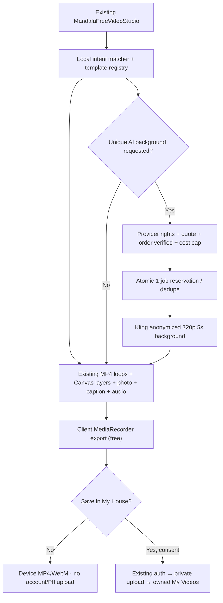

# Holistic House — Personal Video Studio v2
## Техническое задание, архитектура и план реализации

**Версия:** 1.0 · **Дата:** 28 октября 2026 · **Статус:** ТЗ/план; НОВАЯ функциональность v2 НЕ реализована и НЕ live.  
**Единый tracking issue:** https://github.com/andylitvinov-design/books/issues/2397  
**Репозиторий:** https://github.com/andylitvinov-design/books  
**Production-ветка:** `codex/public-book-library` (НЕ default `codex/bootstrap-books`).  
**Сайт:** https://holistichouse.vercel.app.  
**Язык продукта:** EN основной, RU/ES зеркала.  
**Приоритет:** бесплатный автоматический локальный рендер, без расхода AI-кредитов; платный AI — только optional, после проверки оплаты и privacy.

> ВАЖНО: документ определяет следующий этап после уже реализованного локального видеоредактора. Нельзя объявлять реализованными сохранение в My House, клиентскую очередь Kling, подтверждённую оплату AI, отправку личного фото провайдеру или E2E физического iPhone. Никаких платных вызовов настоящим ТЗ не разрешено.

## 1. Цель продукта

По желанию посетителя создать **индивидуальную символическую видеопрактику** с темами:
- **Money / Деньги:** ценность труда, новые возможности, спокойное отношение к оплате.
- **Relationships & Love / Отношения и любовь:** тепло, границы, взаимность, связь.
- **Energy & Support / Энергия и опора:** устойчивость, дыхание, внутренний ресурс.
- **Goals & Meaning / Цели и смыслы:** путь, ясность, направление, намерение.

Клиент формулирует короткое пожелание, выбирает сюжет, эффекты, фото, звук, длительность и формат; видит **реально анимированный предпросмотр** и скачивает видео. По отдельному решению сохраняет MP4 приватно в кабинете. На более поздней стадии за отдельную подтверждённую плату заказывает уникальный AI-фон. Символические изображения и утверждения не должны обещать денежный результат, любовь другого человека или лечебный эффект.

**Стратегия экономии:** 80–90% как плановая доля, НЕ измеренный факт — локальное комбинирование лицензированных динамических фонов, Canvas-слоёв, личного фото и текста. Генерация Kling необязательна и должна затрагивать преимущественно **обезличенный фон**, а не фотографию/голос клиента.

## 2. Фактически существующая база — переиспользовать, не дублировать

Проверено по production-исходникам и Supabase на 28.10.2026:
- Публичная страница: `app/[locale]/holistic-support/mandala/page.tsx`, `/{en,ru,es}/holistic-support/mandala`.
- Клиентский интерфейс: `components/mandala-meditation-client.tsx` и **единый** `components/mandala-free-video-studio.tsx`.
- Движки: `lib/mandala/money-flow-effects.ts`, `cinematic-money-video.ts`, `holistic-video-themes.ts`, `local-video-music.ts`, `real-money-film-library.ts`.
- 12 отдельных брендированных **настоящих H.264 MP4** видеопетель + постеры: `public/videos/holistic-house/money-films-v1/`. Источник — утверждённые переработанные материалы, коммерческие права на финальные композиции дополнительно зафиксировать в asset manifest; нельзя публиковать необработанные исходники поставщика.
- Итого 24 сценария в четырёх темах, 9:16 / 1:1 / 16:9, 10/20/30/60 сек, фотография только в браузере, подписи, настройка скорости/яркости, локальная музыка, MP4/WebM и Share там, где поддерживает браузер. **Это уже функция текущей системы; не планировать повторную разработку.**
- Исторический базис: #2312 и merged #2368, #2359, #2367, #2386. Конкурирующий мобильный редизайн **PR #2388** был открыт при аудите: сверить CI/merge до UI-работ, не перетирать его изменения.
- Публичная студия с пользовательским голосом `/{locale}/video-studio` находится в **PR #2379** / issue #2357 и НЕ считалась live при аудите; использовать после безопасного merge, а не создавать вторую.
- Отдельная owner-only Kling Studio: `/admin/videos`, #2256/#2273/#2331. Она не является публичным клиентским API и её администраторские разрешения нельзя использовать для клиентов.

**Уже существующие данные/платформы:**
- Supabase project `holistichouse` (`shervdixkaxurnaecioe`) в Канаде; `app.accounts`, `app.consent_events`.
- Для платежей есть `app_private.manual_billing_orders` и `app_private.square_service_orders`. Их наличие НЕ доказывает, что конкретный провайдер и платёж AI уже доступны; сначала реальный receipt/webhook/E2E.
- Приватный bucket `hh-client-private-media` (не публичный; лимит 50 МБ, разрешает `video/mp4`, но **не** `video/webm`). Правила прямой загрузки со стороны клиента не подтверждены: использовать только после owner-access/RLS/server-policy аудита.
- `app_private.client_delivery_assets` предназначен для медиа консультаций, `app_private.telegram_owner_video_jobs` — для работы владельца; **не смешивать** их с новым самостоятельным клиентским видеопроектом. Клиентские CRM Contacts ≠ пользовательские приватные профили.
- Кабинет `app/[locale]/app/[[...path]]/page.jsx` и `components/app/app-workspace.jsx` сейчас явно работают с EN/RU; **ES private-cabinet parity нужно отдельно реализовать и проверить**, хотя публичная студия уже EN/RU/ES.

## 3. User stories и порядок экранов

### U1 — Гостевой бесплатный ролик (P1, без аккаунта)
1. Открывает существующую страницу персонального видео; выбирает Money / Relationships / Energy / Goals & Meaning.
2. Вводит пожелание (опционально, до 160 Unicode-символов), например «Хочу принимать достойную оплату за свою работу».
3. Локальная функция `suggestScene` определяет тему и предпочтительные **существующие** сценарии (словари EN/RU/ES + приоритет явного выбора); без LLM, без API, без передачи текста. Пользователь всегда может изменить результат.
4. Выбирает 1 из 24 сцен, скорость, яркость, фон/с фото, язык подписи, музыку/тишину, формат и 10/20/30/60 секунд. Фото JPG/PNG/WebP ≤10 МБ: проверка MIME+magic/dimensions, preview/contain/crop без искажения лица. Отдельный checkbox на право использовать фото.
5. Воспроизводит именно реальные движущиеся кадры, а не статический постер; создаёт видео **локально**, видит длительность, формат файла и воспроизведение готового файла.
6. Скачивает MP4, либо WebM при браузерной несовместимости, или использует Share → Save to Files/Telegram, когда реально поддерживается. Никакой регистрации и принудительной продажи.

**UX:** бесплатный CTA — главный. Рядом компактные кнопки «Изменить», «Сохранить на устройство», «В My House» (добровольно). AI Premium — ниже, явно обозначен как платный и необязательный.

### U2 — «Мои видео» в кабинете (P2, явно опционально)
1. После локального рендера клиент выбирает «Сохранить в My House».
2. Показывается существующая Google/сайтовая авторизация, если нет сессии, и отдельное согласие на хранение файла, срок и удаление; чекбокс **никогда** не выбран автоматически.
3. Сервер перепроверяет текущий `account_id` по доверенной сессии; выдаёт однократное право загрузить **готовый MP4** только в приватный scoped key, например `personal-videos/{account_id}/{project_id}/master.mp4`.
4. После подтверждённого upload/size/MIME/hash сервер создаёт owned record. Сырой личный портрет по умолчанию **не сохраняется** — только готовый MP4 и допустимые метаданные; параметры/пожелания в облако лишь при дополнительном понятном согласии.
5. В существующем My House, под My Practice либо отдельной панелью **My Videos**, клиент видит свои ролики, открывает, скачивает, удаляет и по желанию отзываeт согласие на хранение. Без ссылок на приватные видео в публичном YouTube.
6. Ошибки аккаунта, отменённый upload или переход в другой Google-аккаунт не открывают видео другого пользователя.

**Ограничение:** существующий bucket пока не принимает WebM. Для P2 сначала поддержать MP4; WebM остаётся локальным, пока не одобрено безопасное расширение MIME/pipeline транскодирования. НЕ запускать автоматически дорогой server-FFmpeg для каждого файла.

### U3 — уникальный AI-фон (P3, опционально и строго платно)
1. По умолчанию создаём **безликий** AI-фон по безопасному системному описанию сцены (theme/style/motion/ratio). Не отправляем в Kling лицо/фото, необработанные пожелания, имя, здоровье, ответы тестов, CRM, историю терапии или записи голоса.
2. До появления кнопки заказа backend подтверждает конфигурацию provider/rights/цену и бюджет. UI показывает конкретный provider, модель/720p/5s, расчёт цены, данные обработки и явный opt-in.
3. Пользователь оплачивает через **реально подтверждённый** существующий платёжный маршрут. Клик, «в процессе» и redirect не являются подтверждением: нужна авторитетная provider webhook/receipt и серверный status `paid_verified`.
4. Сервер в транзакции атомарно резервирует право **одной** генерации, проверяет budget+identity+privacy+payment, присваивает уникальный idempotency key и один `external_task_id`. Два клика/timeout/retry не создают второй billable POST.
5. Kling 2.5 Turbo 5s/720p Image-to-Video — первый кандидат только после проверки фактической цены аккаунта и коммерческих прав. Генерировать безопасный фон по принадлежащему Holistic House лицензированному starter-frame; при недоступном тарифе функция остаётся выключенной.
6. Состояния: `awaiting_payment → paid_verified → reserved → submitted → processing → ready` либо `failed` / `delivery_unknown` / `refund_pending`. Timeout POST = **неизвестный исход**, сначала readback task ID и аудит у провайдера, без слепого повтора.
7. После подтверждённого MP4 клиент комбинирует фон со своим фото/подписью **локально**; при добровольном cloud save — приватное хранение из U2. Нет автоматической публикации в соцсетях.
8. «Оживить именно моё лицо» — **не входит в P3**. Отдельный будущий P4: расширенное согласие на биометрию, права на лицо/голос, политика поставщика, лимит тарифа и пробное QA. Нельзя подменять реальное лицо случайным аватаром.

## 4. Архитектура: local-first / provider last

### Технологии и границы
- **Оставить Canvas + лицензированные MP4 loops + WebAudio + MediaRecorder**, которые уже в проекте. PixiJS — только если профилирование выявит реальный performance/visual gap; не добавлять новый движок ради модного стека. Remotion/другой облачный рендерер в MVP НЕ обязателен.
- Клиентское `lib/mandala/personal-video-intent.ts` (новое маленькое pure utility) + versioned manifest существующих сцен. Хранить у каждой сцены `id/theme/keywords/locale/prompts/asset_version/license_reference/background_only`. Поскольку 24 сцены и 12 MP4 уже есть, **не генерировать их заново и не загружать чужие raw footage в репозиторий**.
- Обеспечить проверку `MediaRecorder.isTypeSupported` и честный MP4/WebM fallback; в Safari/WebKit на реальном iPhone возможны memory/codec failures. Файл «готов» только после playable/decode/readback, не после клика или вызова `recorder.stop()`.
- Предпросмотр: ленивое декодирование; одна движущаяся карточка за раз, pause offscreen, нет autoplay; постер-first, минимум 44×44px touch targets, 320–430px без горизонтального overflow. Первый интерактивный кадр цель ≤2с (измерить на средней модели iPhone), рендер ≤2.5× клип-реалтайма p75 (проверить).
- Не использовать Vercel Functions для постоянного много-секундного видеорендера: по умолчанию кодирование локально. Backend-путь/FFmpeg только в отдельно обоснованном fallback P2, после измерений, согласия на upload и budget review.

## 5. API и контракты (только проектирование; НЕ существуют)

P1 free: **нет новых HTTP API** — чистые клиентские функции и сохранение на устройстве.

P2 owner-private:
- `GET /api/app/personal-videos` → список только текущего `account_id`, курсорная пагинация.
- `POST /api/app/personal-videos` → создать owned draft/metadata, требует signed-in identity и storage consent version.
- `POST /api/app/personal-videos/{id}/upload-url` → проверить owner, размер/MIME/quotas и вернуть scoped короткоживущий upload-token.
- `POST /api/app/personal-videos/{id}/complete` → server-side HEAD/object-size/MIME/hash reconciliation, статус `ready`.
- `GET /api/app/personal-videos/{id}/download` → private signed URL на короткий срок либо поток с серверной авторизацией; не кэшировать, Referrer-Policy no-referrer.
- `DELETE /api/app/personal-videos/{id}` → отозвать доступ, запланировать deletion и выдать подтверждённый результат.

P3:
- `POST /api/app/personal-videos/{id}/ai/quote` → read-only стоимость/лицензия/политика, no task.
- `POST /api/app/personal-videos/{id}/ai/request` → авторизация, consent, provider config, **paid_verified**, atomic spend reservation, idempotency, один task.
- `GET /api/app/personal-videos/{id}/ai/status` → авторизованный статус, не polling каждые секунды; read-only.
- Подписанный provider callback **только после** официальной verification protocol; альтернативно bounded scheduled readback. Не открывать anonymous task-query endpoint.

**Все** state-changing запросы: server-side session, origin/CSRF, per-user and IP rate limiting, no arbitrary external file URLs/SSRF, body size cap, input allowlists, request ID, generic sanitized failures, no raw client data/keys in логи.

## 6. Данные и приватное хранилище

При проектировании P2 сначала проверить доступные приватные модели; новые таблицы **только если нет подходящей owned сущности**:
- `app_private.personal_video_projects`: `id, account_id, locale, theme, scene_id, scene_version, output_format, duration, caption_mode, consent_event_id, status, storage_object_key, mime, bytes, created_at, updated_at, deleted_at`. Пользовательское личное пожелание **локально по умолчанию**; хранение текста отдельным opt-in. Фотография не сохраняется автоматически.
- `app_private.personal_video_jobs` (только P3): `id, project_id, account_id, request_key UNIQUE, provider, model, provider_task_id UNIQUE, external_task_id UNIQUE, order_id, cost_quote_minor, cost_cap_minor, actual_cost_minor, currency, status, safe_error_code, created_at, updated_at`. Уникальность и транзакционные reservation исключают двойную отправку.
- Согласие — **переиспользовать** `app.consent_events`, цели с версией: `personal_video_local_photo_rights`, `personal_video_cloud_save_v1`, `personal_video_external_ai_v1` и отдельная биометрия только в будущем. Фото-rights локально не требует записи в БД при гостевом режиме.
- Хранение — пробовать **существующий private bucket** `hh-client-private-media` с выделенным namespace и server-side account gate. RLS/storage policy необходимо проверить до реализации: наличие приватного bucket **само по себе не гарантирует разграничение доступа**. Не использовать service role в браузере; private signed URLs с малым TTL. Не считать URL отзываемым до истечения TTL.
- Схема `app_private` не должна открываться в Supabase Data API; дополнительные таблицы с RLS для defense-in-depth и никаких grants anon. Проектные миграции через принятый Supabase workflow; SQL/prod изменения ТЗ НЕ выполняет.
- Предлагаемая политика хранения (подлежит согласованию): временный upload/delete 24ч, незавершённые проекты 30д, сохранённый master до удаления пользователем, удаление приватных исходников и отзыва доступов при account delete. Регулярный cleanup только после privacy review, не включать cron/платный worker заранее.

## 7. Оплата и пределы расходов

- Сохранять текущие production OFF-флаги: `HH_KLING_PAID_GENERATION_ENABLED=false`, `HH_KLING_AVATAR_PAID_ENABLED=false`, `HH_KLING_PREMIUM_RENDER_ENABLED=false` (первый хранится как Sensitive, значение было принудительно установлено ранее).
- Дополнительный клиентский feature flag (только P3): `HH_CLIENT_VIDEO_AI_ENABLED=false`, а также server-side total/month cap и per-order reserve; **не создавать и не включать эти переменные при написании ТЗ**.
- **Не покупать** подписку Kling/MCP, не подключать авто-top-up, рекламу и платный Vercel worker без разрешения. Бесплатный режим = 0 AI-кредитов на каждый экспорт, но не 0 общая стоимость CDN/передачи.
- База для расчёта Premium — актуальные **реальные цены конкретного провайдера и пакета**. Для Kling 2.5 Turbo официально документируется 5s/720p и уникальный external_task_id; единицы Kling API ≠ доллары Gateway ≠ потребительские кредиты. Не обещать фиксированную себестоимость до чтения billable receipt.
- Платежи только через реально проверенный пользовательский маршрут и receipt/webhook. Текущие Square/manual order схемы **кандидаты на reuse**, но наличие таблиц не является доказательством business-аккаунта/работающего checkout. Ставить AI Premium в disabled/waitlist, пока нет реального E2E.
- Для fail/refund/status: invoice/paid receipt → provider task → actual delivery; клиенту не обещать «видео создано», пока нет playable master. При provider failure — безопасный возврат/кредит только согласно подтверждённой политике продавца.

## 8. Privacy, контент, юридические ограничения

- Фото, голос, текст пожелания, тесты/здоровье **не отправлять** в GA4/Meta, SMS/Telegram/WhatsApp/push, Kling или третьим лицам без отдельных оснований/разрешений. Нейтральное уведомление может содержать только «Ваше видео готово» + ссылку в защищённый кабинет.
- Клиент подтверждает право на фото. Нельзя передавать фото другого человека, приватные терапевтические материалы, чужой голос или AI-биометрию без нужных прав.
- Kling P3 генерирует безопасную абстрактную сцену из категории и стилевых тегов. **Нельзя автоматически копировать ввод клиента в провайдерский prompt**, даже если клиент пожелал деньги/любовь/здоровье.
- Символическая медитация ≠ диагностика, лечение, контроль чувств другого человека, доказательство фактических доходов или гарантия исполнения желаний.
- Публичные MP4 loops имеют смешанное происхождение и ограничение сырого повторного распространения: завести `license/asset provenance manifest`, проверку коммерческих прав конечного брендированного remix и сроков/атрибуции до широкого рекламного применения.
- Страна и договоры передачи персональных данных зависят от реального провайдера/региона; не предполагать локальность Kling. Предусмотреть privacy notice EN/RU/ES и возможность полного удаления.

## 9. Definition of Done / тестовая матрица

**P1 Free**
- [ ] Все 4 категории, все 24 актуальные сцены доступны и реально двигаются, chosen theme не теряется при переключении EN/RU/ES.
- [ ] Пожелание превращается в локальный редактируемый выбор, не уходит через network и не заменяет решение пользователя.
- [ ] Собранные файлы реально декодируются: video duration, dimensions, codec/audio, первые/последние кадры и отсутствие пустого видео. Нельзя принимать пустой Blob за успех.
- [ ] Фото не отправляется вообще (network interception assertion); клиент может работать без Google; права на фото явно подтверждены.
- [ ] Chromium и WebKit 320/375/390/430px: touch, scroll, template switching, pause/play, crop/contain, captions EN/RU/ES, Share/Files fallback, low-memory fail-safe. **Реальный физический iPhone** проверяется отдельно.
- [ ] Существующие guided meditations, манадалы и владельческий Kling Studio не ломаются.

**P2 My House**
- [ ] Google/signed-in owner verification before save; guest save redirects without losing local file until permitted handoff; account switch invalidates access.
- [ ] Owner can list/play/download/delete only OWN saved MP4. Другой account ID → 401/403/404, no leaked metadata or signed URL.
- [ ] Storage MIME/size limits, no direct service-role, short-lived URLs, timeout/retry and double upload idempotency tested.
- [ ] ES auth/cabinet parity explicitly resolved before claiming EN/RU/ES private E2E; until then ES free public remains available but cloud save disabled with truthful explanation.

**P3 AI**
- [ ] Paid flag OFF blocks every call, including forged requests.
- [ ] Wrong/unknown payment, consent absent, account switch, expired quote, max budget or duplicate request → **zero provider POST**.
- [ ] Exactly one short provider job after real receipt, verified task ID, status and MP4; report exact consumed units/currency from provider response where available.
- [ ] Failure, delivery_unknown, cancellation, refund and private result accessibility demonstrated end-to-end. No automatic public YouTube/website posting.

**Release for each stage:** changed-path unit + scoped ESLint + typecheck + Next build + Chromium/WebKit; isolated Supabase RLS/security advisors and storage policy audits if P2/P3; PR diff/current production base; safe squash merge only to `codex/public-book-library`, Vercel READY SHA and `holistichouse.vercel.app` alias, EN/RU/ES smoke. A green build/HTTP 200/mock alone is not real delivered video/payment/physical iPhone acceptance.

## 10. Implementation plan — small PRs, existing modules first

| Этап | Scope / код | Готовность | Оценка разработки* | Зависимости |
| --- | --- | --- | --- | --- |
| **P0 · Baseline** | Сверить live PR #2388 / #2379, license manifest, iPhone exporter + no-upload privacy QA; устранить только фактические регрессии | реальный EN/RU/ES free export + documented iPhone gap | 1–2 инжен.-дня | текущий live, владелец для реального iPhone QA |
| **P1 · Intent Personalization** | `personal-video-intent.ts`; добавить локальный wish→theme/scene suggestion + opt-in preview в **MandalaFreeVideoStudio**, без нового маршрута/базы/LLM | word inputs map to 24 scenes; user override; free playable MP4/WebM | 3–5 инжен.-дней | P0 |
| **P2 · Private My Videos** | existing account/My House integration, private MP4 upload endpoint, minimal owned metadata, consent_events, delete/download; private storage audit | owner-only save/read/delete real E2E, account switch/IDOR/RLS, ES parity | 5–8 инжен.-дней | P1, storage policy, auth/ES design |
| **P3 · Gated AI Premium** | sandbox quote/verified order, idempotent per-client short background Kling job, spend ceiling, status, private result | 1 actual owner-approved low-cost provider job + verified payment/delivery/refund tests | 6–10 инжен.-дней | P2, approved spend+license+payment E2E |
| **P4 · Release & KPIs** | progressive flags, accessibility/perf/mobile, privacy-safe aggregate funnel (only after hold review), QA scripts | exact production READY/SHA/alias and device/provider attestation | 2–4 инжен.-дня суммарно | each stage |

*Оценки — инженерные дни для планирования, не обещание даты или расходы. Работать инкрементально, без новых дорогих сервисов. P0+P1 уже создают ценность при **нулевых AI API-вызовах**; P2/P3 самостоятельные optional decision gates.

**Порядок PR/CI:**
1. `feat/personal-video-intent` — только существующие Mandala компоненты/локальные функции/тесты.
2. `feat/personal-video-my-house` — auth + приватный MP4 save + minimal schema/policies + E2E (НЕ открывать CRM Contacts).
3. `feat/personal-video-ai-background` — отдельные server flags, safe source prompt, verified billing + task ledger, provider QA. НЕ начинать до разрешения стоимости и оплаты.
4. Продолжение **того же** видео-редактора и исходников; авторскую публикацию/Drive-архив не автоматически включать в клиентский процесс.

## 11. Метрики и этапный rollout

- Базовые: доля начала/завершения локального рендера, download/share, процент ошибок Safari/Android и размер готового видео. Считать **только агрегаты без фото, пожеланий, результатов тестов и секретов** и исключительно после разрешённой privacy-политики.
- P2: opt-in save completion, private deletion success, API/storage egress.
- P3: реальные оплаченные jobs, paid-to-delivered ratio, средний provider unit cost, fail/unknown и refund rate; zero duplicate provider charges.
- Rollout: internal owner → тестовая группа с явным согласием → 5–10% клиентов (если consented analytics) → общий доступ. В случае ошибок flag OFF, бесплатная локальная генерация продолжает работать.

## 12. Открытые решения владельца (не мешают P0/P1)

1. Согласовать тексты уведомления/политики хранения и сроков удаления для cloud save. По умолчанию ничего не хранить.
2. Перед P3: определить доступный коммерческий платёжный метод, клиентскую цену, **строгий максимальный бюджет в валюте**, commercial rights и отдельное разрешение одной фактической Kling-генерации. Пока все флаги OFF.
3. Для независимого acceptance: 1 согласованный физический iPhone Safari / Telegram in-app тест локального MP4/Share-to-Files. Без фото клиентов вне QA с их согласия.

## 13. Ссылки и источники

**Текущие задачи:** 
- Existing editor #2312: https://github.com/andylitvinov-design/books/issues/2312
- Public voice studio #2357 / PR #2379: https://github.com/andylitvinov-design/books/issues/2357
- Kling owner pilot #2256: https://github.com/andylitvinov-design/books/issues/2256
- Payments/lead funnel #990: https://github.com/andylitvinov-design/books/issues/990
- CRM privacy #985: https://github.com/andylitvinov-design/books/issues/985
- Product video SOP: https://github.com/andylitvinov-design/ai-projects-brain/issues/219
- Video asset PR #2386 (12 licensed MP4), layout PR #2388 (not merged at audit), mobile editor merged #2368.

**Официальная техника:**
- Browser capture: https://developer.mozilla.org/en-US/docs/Web/API/HTMLCanvasElement/captureStream
- Browser codec capability: https://developer.mozilla.org/en-US/docs/Web/API/MediaRecorder/isTypeSupported_static
- Supabase Storage private access: https://supabase.com/docs/guides/storage/buckets/fundamentals
- Supabase Storage RLS: https://supabase.com/docs/guides/storage/security/access-control
- Supabase signed upload URLs: https://supabase.com/docs/reference/javascript/file-buckets-createsigneduploadurl
- Kling Turbo API: https://kling.ai/document-api/api/video/2-5-turbo
- Kling account (read-only; resource values may lag): https://kling.ai/document-api/api/assets/account-usage

---
**Что НЕ было сделано этим ТЗ:** новая клиентская облачная таблица, API, настройка провайдера, реальные расходы, оплата, любой новый видеофайл или публикация. ТЗ готово к инкрементальной реализации с проверкой каждого этапа.
