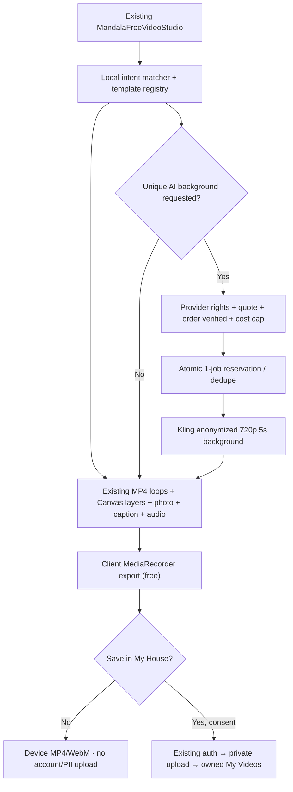

# Holistic House — Personal Video Studio v2
## Техническое задание, архитектура и план реализации

**Версия:** 1.1 (детализация по мобильному скриншоту 28.10.2026) · **Дата:** 28 октября 2026 · **Статус:** ТЗ/план; НОВАЯ функциональность v2 НЕ реализована и НЕ live.  
**Единый tracking issue:** https://github.com/andylitvinov-design/books/issues/2397  
**Репозиторий:** https://github.com/andylitvinov-design/books  
**Production-ветка:** `codex/public-book-library` (НЕ default `codex/bootstrap-books`).  
**Сайт:** https://holistichouse.vercel.app.  
**Язык продукта:** EN основной, RU/ES зеркала.  
**Приоритет:** бесплатный автоматический локальный рендер, без расхода AI-кредитов; платный AI — только optional, после проверки оплаты и privacy.

> ВАЖНО: документ определяет следующий этап после уже реализованного локального видеоредактора. Нельзя объявлять реализованными сохранение в My House, клиентскую очередь Kling, подтверждённую оплату AI, отправку личного фото провайдеру или E2E физического iPhone. Никаких платных вызовов настоящим ТЗ не разрешено.

**Приоритет обновления v1.1:** точная матрица 4 экранных шагов/фильтров, честный статус кнопки «Мои видео», реальные возможности аудио и экспортирования, конкретная архитектура My House и тесты. См. §§ 14–20 ниже.

## 1. Цель продукта

По желанию посетителя создать **индивидуальную символическую видеопрактику** с темами:
- **Money / Деньги:** ценность труда, новые возможности, спокойное отношение к оплате.
- **Relationships & Love / Отношения и любовь:** тепло, границы, взаимность, связь.
- **Energy & Support / Энергия и опора:** устойчивость, дыхание, внутренний ресурс.
- **Goals & Meaning / Цели и смыслы:** путь, ясность, направление, намерение.

Клиент формулирует короткое пожелание, выбирает сюжет, эффекты, фото, звук, длительность и формат; видит **реально анимированный предпросмотр** и скачивает видео. По отдельному решению сохраняет MP4 приватно в кабинете. На более поздней стадии за отдельную подтверждённую плату заказывает уникальный AI-фон. Символические изображения и утверждения не должны обещать денежный результат, любовь другого человека или лечебный эффект.

**Стратегия экономии:** 80–90% как плановая доля, НЕ измеренный факт — локальное комбинирование лицензированных динамических фонов, Canvas-слоёв, личного фото и текста. Генерация Kling необязательна и должна затрагивать преимущественно **обезличенный фон**, а не фотографию/голос клиента.

## 2. Фактически существующая база — переиспользовать, не дублировать

Проверено по production-исходникам и Supabase на 28.10.2026:
- Публичная страница: `app/[locale]/holistic-support/mandala/page.tsx`, `/{en,ru,es}/holistic-support/mandala`.
- Клиентский интерфейс: `components/mandala-meditation-client.tsx` и **единый** `components/mandala-free-video-studio.tsx`.
- Движки: `lib/mandala/money-flow-effects.ts`, `cinematic-money-video.ts`, `holistic-video-themes.ts`, `local-video-music.ts`, `real-money-film-library.ts`.
- 12 отдельных брендированных **настоящих H.264 MP4** видеопетель + постеры: `public/videos/holistic-house/money-films-v1/`. Источник — утверждённые переработанные материалы, коммерческие права на финальные композиции дополнительно зафиксировать в asset manifest; нельзя публиковать необработанные исходники поставщика.
- Итого 24 сценария в четырёх темах, 9:16 / 1:1 / 16:9, 10/20/30/60 сек, фотография только в браузере, подписи, настройка скорости/яркости, локальная музыка, MP4/WebM и Share там, где поддерживает браузер. **Это уже функция текущей системы; не планировать повторную разработку.**
- Исторический базис: #2312 и merged #2368, #2359, #2367, #2386. Конкурирующий мобильный редизайн **PR #2388** был открыт при аудите: сверить CI/merge до UI-работ, не перетирать его изменения.
- Публичная студия с пользовательским голосом `/{locale}/video-studio` находится в **PR #2379** / issue #2357 и НЕ считалась live при аудите; использовать после безопасного merge, а не создавать вторую.
- Отдельная owner-only Kling Studio: `/admin/videos`, #2256/#2273/#2331. Она не является публичным клиентским API и её администраторские разрешения нельзя использовать для клиентов.

**Уже существующие данные/платформы:**
- Supabase project `holistichouse` (`shervdixkaxurnaecioe`) в Канаде; `app.accounts`, `app.consent_events`.
- Для платежей есть `app_private.manual_billing_orders` и `app_private.square_service_orders`. Их наличие НЕ доказывает, что конкретный провайдер и платёж AI уже доступны; сначала реальный receipt/webhook/E2E.
- Приватный bucket `hh-client-private-media` (не публичный; лимит 50 МБ, разрешает `video/mp4`, но **не** `video/webm`). Правила прямой загрузки со стороны клиента не подтверждены: использовать только после owner-access/RLS/server-policy аудита.
- `app_private.client_delivery_assets` предназначен для медиа консультаций, `app_private.telegram_owner_video_jobs` — для работы владельца; **не смешивать** их с новым самостоятельным клиентским видеопроектом. Клиентские CRM Contacts ≠ пользовательские приватные профили.
- Кабинет `app/[locale]/app/[[...path]]/page.jsx` и `components/app/app-workspace.jsx` сейчас явно работают с EN/RU; **ES private-cabinet parity нужно отдельно реализовать и проверить**, хотя публичная студия уже EN/RU/ES.

## 3. User stories и порядок экранов

### U1 — Гостевой бесплатный ролик (P1, без аккаунта)
1. Открывает существующую страницу персонального видео; выбирает Money / Relationships / Energy / Goals & Meaning.
2. Вводит пожелание (опционально, до 160 Unicode-символов), например «Хочу принимать достойную оплату за свою работу».
3. Локальная функция `suggestScene` определяет тему и предпочтительные **существующие** сценарии (словари EN/RU/ES + приоритет явного выбора); без LLM, без API, без передачи текста. Пользователь всегда может изменить результат.
4. Выбирает 1 из 24 сцен, скорость, яркость, фон/с фото, язык подписи, музыку/тишину, формат и 10/20/30/60 секунд. Фото JPG/PNG/WebP ≤10 МБ: проверка MIME+magic/dimensions, preview/contain/crop без искажения лица. Отдельный checkbox на право использовать фото.
5. Воспроизводит именно реальные движущиеся кадры, а не статический постер; создаёт видео **локально**, видит длительность, формат файла и воспроизведение готового файла.
6. Скачивает MP4, либо WebM при браузерной несовместимости, или использует Share → Save to Files/Telegram, когда реально поддерживается. Никакой регистрации и принудительной продажи.

**UX:** бесплатный CTA — главный. Рядом компактные кнопки «Изменить», «Сохранить на устройство», «В My House» (добровольно). AI Premium — ниже, явно обозначен как платный и необязательный.

### U2 — «Мои видео» в кабинете (P2, явно опционально)
1. После локального рендера клиент выбирает «Сохранить в My House».
2. Показывается существующая Google/сайтовая авторизация, если нет сессии, и отдельное согласие на хранение файла, срок и удаление; чекбокс **никогда** не выбран автоматически.
3. Сервер перепроверяет текущий `account_id` по доверенной сессии; выдаёт однократное право загрузить **готовый MP4** только в приватный scoped key, например `personal-videos/{account_id}/{project_id}/master.mp4`.
4. После подтверждённого upload/size/MIME/hash сервер создаёт owned record. Сырой личный портрет по умолчанию **не сохраняется** — только готовый MP4 и допустимые метаданные; параметры/пожелания в облако лишь при дополнительном понятном согласии.
5. В существующем My House, под My Practice либо отдельной панелью **My Videos**, клиент видит свои ролики, открывает, скачивает, удаляет и по желанию отзываeт согласие на хранение. Без ссылок на приватные видео в публичном YouTube.
6. Ошибки аккаунта, отменённый upload или переход в другой Google-аккаунт не открывают видео другого пользователя.

**Ограничение:** существующий bucket пока не принимает WebM. Для P2 сначала поддержать MP4; WebM остаётся локальным, пока не одобрено безопасное расширение MIME/pipeline транскодирования. НЕ запускать автоматически дорогой server-FFmpeg для каждого файла.

### U3 — уникальный AI-фон (P3, опционально и строго платно)
1. По умолчанию создаём **безликий** AI-фон по безопасному системному описанию сцены (theme/style/motion/ratio). Не отправляем в Kling лицо/фото, необработанные пожелания, имя, здоровье, ответы тестов, CRM, историю терапии или записи голоса.
2. До появления кнопки заказа backend подтверждает конфигурацию provider/rights/цену и бюджет. UI показывает конкретный provider, модель/720p/5s, расчёт цены, данные обработки и явный opt-in.
3. Пользователь оплачивает через **реально подтверждённый** существующий платёжный маршрут. Клик, «в процессе» и redirect не являются подтверждением: нужна авторитетная provider webhook/receipt и серверный status `paid_verified`.
4. Сервер в транзакции атомарно резервирует право **одной** генерации, проверяет budget+identity+privacy+payment, присваивает уникальный idempotency key и один `external_task_id`. Два клика/timeout/retry не создают второй billable POST.
5. Kling 2.5 Turbo 5s/720p Image-to-Video — первый кандидат только после проверки фактической цены аккаунта и коммерческих прав. Генерировать безопасный фон по принадлежащему Holistic House лицензированному starter-frame; при недоступном тарифе функция остаётся выключенной.
6. Состояния: `awaiting_payment → paid_verified → reserved → submitted → processing → ready` либо `failed` / `delivery_unknown` / `refund_pending`. Timeout POST = **неизвестный исход**, сначала readback task ID и аудит у провайдера, без слепого повтора.
7. После подтверждённого MP4 клиент комбинирует фон со своим фото/подписью **локально**; при добровольном cloud save — приватное хранение из U2. Нет автоматической публикации в соцсетях.
8. «Оживить именно моё лицо» — **не входит в P3**. Отдельный будущий P4: расширенное согласие на биометрию, права на лицо/голос, политика поставщика, лимит тарифа и пробное QA. Нельзя подменять реальное лицо случайным аватаром.

## 4. Архитектура: local-first / provider last

### Технологии и границы
- **Оставить Canvas + лицензированные MP4 loops + WebAudio + MediaRecorder**, которые уже в проекте. PixiJS — только если профилирование выявит реальный performance/visual gap; не добавлять новый движок ради модного стека. Remotion/другой облачный рендерер в MVP НЕ обязателен.
- Клиентское `lib/mandala/personal-video-intent.ts` (новое маленькое pure utility) + versioned manifest существующих сцен. Хранить у каждой сцены `id/theme/keywords/locale/prompts/asset_version/license_reference/background_only`. Поскольку 24 сцены и 12 MP4 уже есть, **не генерировать их заново и не загружать чужие raw footage в репозиторий**.
- Обеспечить проверку `MediaRecorder.isTypeSupported` и честный MP4/WebM fallback; в Safari/WebKit на реальном iPhone возможны memory/codec failures. Файл «готов» только после playable/decode/readback, не после клика или вызова `recorder.stop()`.
- Предпросмотр: ленивое декодирование; одна движущаяся карточка за раз, pause offscreen, нет autoplay; постер-first, минимум 44×44px touch targets, 320–430px без горизонтального overflow. Первый интерактивный кадр цель ≤2с (измерить на средней модели iPhone), рендер ≤2.5× клип-реалтайма p75 (проверить).
- Не использовать Vercel Functions для постоянного много-секундного видеорендера: по умолчанию кодирование локально. Backend-путь/FFmpeg только в отдельно обоснованном fallback P2, после измерений, согласия на upload и budget review.

## 5. API и контракты (только проектирование; НЕ существуют)

P1 free: **нет новых HTTP API** — чистые клиентские функции и сохранение на устройстве.

P2 owner-private:
- `GET /api/app/personal-videos` → список только текущего `account_id`, курсорная пагинация.
- `POST /api/app/personal-videos` → создать owned draft/metadata, требует signed-in identity и storage consent version.
- `POST /api/app/personal-videos/{id}/upload-url` → проверить owner, размер/MIME/quotas и вернуть scoped короткоживущий upload-token.
- `POST /api/app/personal-videos/{id}/complete` → server-side HEAD/object-size/MIME/hash reconciliation, статус `ready`.
- `GET /api/app/personal-videos/{id}/download` → private signed URL на короткий срок либо поток с серверной авторизацией; не кэшировать, Referrer-Policy no-referrer.
- `DELETE /api/app/personal-videos/{id}` → отозвать доступ, запланировать deletion и выдать подтверждённый результат.

P3:
- `POST /api/app/personal-videos/{id}/ai/quote` → read-only стоимость/лицензия/политика, no task.
- `POST /api/app/personal-videos/{id}/ai/request` → авторизация, consent, provider config, **paid_verified**, atomic spend reservation, idempotency, один task.
- `GET /api/app/personal-videos/{id}/ai/status` → авторизованный статус, не polling каждые секунды; read-only.
- Подписанный provider callback **только после** официальной verification protocol; альтернативно bounded scheduled readback. Не открывать anonymous task-query endpoint.

**Все** state-changing запросы: server-side session, origin/CSRF, per-user and IP rate limiting, no arbitrary external file URLs/SSRF, body size cap, input allowlists, request ID, generic sanitized failures, no raw client data/keys in логи.

## 6. Данные и приватное хранилище

При проектировании P2 сначала проверить доступные приватные модели; новые таблицы **только если нет подходящей owned сущности**:
- `app_private.personal_video_projects`: `id, account_id, locale, theme, scene_id, scene_version, output_format, duration, caption_mode, consent_event_id, status, storage_object_key, mime, bytes, created_at, updated_at, deleted_at`. Пользовательское личное пожелание **локально по умолчанию**; хранение текста отдельным opt-in. Фотография не сохраняется автоматически.
- `app_private.personal_video_jobs` (только P3): `id, project_id, account_id, request_key UNIQUE, provider, model, provider_task_id UNIQUE, external_task_id UNIQUE, order_id, cost_quote_minor, cost_cap_minor, actual_cost_minor, currency, status, safe_error_code, created_at, updated_at`. Уникальность и транзакционные reservation исключают двойную отправку.
- Согласие — **переиспользовать** `app.consent_events`, цели с версией: `personal_video_local_photo_rights`, `personal_video_cloud_save_v1`, `personal_video_external_ai_v1` и отдельная биометрия только в будущем. Фото-rights локально не требует записи в БД при гостевом режиме.
- Хранение — пробовать **существующий private bucket** `hh-client-private-media` с выделенным namespace и server-side account gate. RLS/storage policy необходимо проверить до реализации: наличие приватного bucket **само по себе не гарантирует разграничение доступа**. Не использовать service role в браузере; private signed URLs с малым TTL. Не считать URL отзываемым до истечения TTL.
- Схема `app_private` не должна открываться в Supabase Data API; дополнительные таблицы с RLS для defense-in-depth и никаких grants anon. Проектные миграции через принятый Supabase workflow; SQL/prod изменения ТЗ НЕ выполняет.
- Предлагаемая политика хранения (подлежит согласованию): временный upload/delete 24ч, незавершённые проекты 30д, сохранённый master до удаления пользователем, удаление приватных исходников и отзыва доступов при account delete. Регулярный cleanup только после privacy review, не включать cron/платный worker заранее.

## 7. Оплата и пределы расходов

- Сохранять текущие production OFF-флаги: `HH_KLING_PAID_GENERATION_ENABLED=false`, `HH_KLING_AVATAR_PAID_ENABLED=false`, `HH_KLING_PREMIUM_RENDER_ENABLED=false` (первый хранится как Sensitive, значение было принудительно установлено ранее).
- Дополнительный клиентский feature flag (только P3): `HH_CLIENT_VIDEO_AI_ENABLED=false`, а также server-side total/month cap и per-order reserve; **не создавать и не включать эти переменные при написании ТЗ**.
- **Не покупать** подписку Kling/MCP, не подключать авто-top-up, рекламу и платный Vercel worker без разрешения. Бесплатный режим = 0 AI-кредитов на каждый экспорт, но не 0 общая стоимость CDN/передачи.
- База для расчёта Premium — актуальные **реальные цены конкретного провайдера и пакета**. Для Kling 2.5 Turbo официально документируется 5s/720p и уникальный external_task_id; единицы Kling API ≠ доллары Gateway ≠ потребительские кредиты. Не обещать фиксированную себестоимость до чтения billable receipt.
- Платежи только через реально проверенный пользовательский маршрут и receipt/webhook. Текущие Square/manual order схемы **кандидаты на reuse**, но наличие таблиц не является доказательством business-аккаунта/работающего checkout. Ставить AI Premium в disabled/waitlist, пока нет реального E2E.
- Для fail/refund/status: invoice/paid receipt → provider task → actual delivery; клиенту не обещать «видео создано», пока нет playable master. При provider failure — безопасный возврат/кредит только согласно подтверждённой политике продавца.

## 8. Privacy, контент, юридические ограничения

- Фото, голос, текст пожелания, тесты/здоровье **не отправлять** в GA4/Meta, SMS/Telegram/WhatsApp/push, Kling или третьим лицам без отдельных оснований/разрешений. Нейтральное уведомление может содержать только «Ваше видео готово» + ссылку в защищённый кабинет.
- Клиент подтверждает право на фото. Нельзя передавать фото другого человека, приватные терапевтические материалы, чужой голос или AI-биометрию без нужных прав.
- Kling P3 генерирует безопасную абстрактную сцену из категории и стилевых тегов. **Нельзя автоматически копировать ввод клиента в провайдерский prompt**, даже если клиент пожелал деньги/любовь/здоровье.
- Символическая медитация ≠ диагностика, лечение, контроль чувств другого человека, доказательство фактических доходов или гарантия исполнения желаний.
- Публичные MP4 loops имеют смешанное происхождение и ограничение сырого повторного распространения: завести `license/asset provenance manifest`, проверку коммерческих прав конечного брендированного remix и сроков/атрибуции до широкого рекламного применения.
- Страна и договоры передачи персональных данных зависят от реального провайдера/региона; не предполагать локальность Kling. Предусмотреть privacy notice EN/RU/ES и возможность полного удаления.

## 9. Definition of Done / тестовая матрица

**P1 Free**
- [ ] Все 4 категории, все 24 актуальные сцены доступны и реально двигаются, chosen theme не теряется при переключении EN/RU/ES.
- [ ] Пожелание превращается в локальный редактируемый выбор, не уходит через network и не заменяет решение пользователя.
- [ ] Собранные файлы реально декодируются: video duration, dimensions, codec/audio, первые/последние кадры и отсутствие пустого видео. Нельзя принимать пустой Blob за успех.
- [ ] Фото не отправляется вообще (network interception assertion); клиент может работать без Google; права на фото явно подтверждены.
- [ ] Chromium и WebKit 320/375/390/430px: touch, scroll, template switching, pause/play, crop/contain, captions EN/RU/ES, Share/Files fallback, low-memory fail-safe. **Реальный физический iPhone** проверяется отдельно.
- [ ] Существующие guided meditations, манадалы и владельческий Kling Studio не ломаются.

**P2 My House**
- [ ] Google/signed-in owner verification before save; guest save redirects without losing local file until permitted handoff; account switch invalidates access.
- [ ] Owner can list/play/download/delete only OWN saved MP4. Другой account ID → 401/403/404, no leaked metadata or signed URL.
- [ ] Storage MIME/size limits, no direct service-role, short-lived URLs, timeout/retry and double upload idempotency tested.
- [ ] ES auth/cabinet parity explicitly resolved before claiming EN/RU/ES private E2E; until then ES free public remains available but cloud save disabled with truthful explanation.

**P3 AI**
- [ ] Paid flag OFF blocks every call, including forged requests.
- [ ] Wrong/unknown payment, consent absent, account switch, expired quote, max budget or duplicate request → **zero provider POST**.
- [ ] Exactly one short provider job after real receipt, verified task ID, status and MP4; report exact consumed units/currency from provider response where available.
- [ ] Failure, delivery_unknown, cancellation, refund and private result accessibility demonstrated end-to-end. No automatic public YouTube/website posting.

**Release for each stage:** changed-path unit + scoped ESLint + typecheck + Next build + Chromium/WebKit; isolated Supabase RLS/security advisors and storage policy audits if P2/P3; PR diff/current production base; safe squash merge only to `codex/public-book-library`, Vercel READY SHA and `holistichouse.vercel.app` alias, EN/RU/ES smoke. A green build/HTTP 200/mock alone is not real delivered video/payment/physical iPhone acceptance.

## 10. Implementation plan — small PRs, existing modules first

| Этап | Scope / код | Готовность | Оценка разработки* | Зависимости |
| --- | --- | --- | --- | --- |
| **P0 · Baseline** | Сверить live PR #2388 / #2379, license manifest, iPhone exporter + no-upload privacy QA; устранить только фактические регрессии | реальный EN/RU/ES free export + documented iPhone gap | 1–2 инжен.-дня | текущий live, владелец для реального iPhone QA |
| **P1 · Intent Personalization** | `personal-video-intent.ts`; добавить локальный wish→theme/scene suggestion + opt-in preview в **MandalaFreeVideoStudio**, без нового маршрута/базы/LLM | word inputs map to 24 scenes; user override; free playable MP4/WebM | 3–5 инжен.-дней | P0 |
| **P2 · Private My Videos** | existing account/My House integration, private MP4 upload endpoint, minimal owned metadata, consent_events, delete/download; private storage audit | owner-only save/read/delete real E2E, account switch/IDOR/RLS, ES parity | 5–8 инжен.-дней | P1, storage policy, auth/ES design |
| **P3 · Gated AI Premium** | sandbox quote/verified order, idempotent per-client short background Kling job, spend ceiling, status, private result | 1 actual owner-approved low-cost provider job + verified payment/delivery/refund tests | 6–10 инжен.-дней | P2, approved spend+license+payment E2E |
| **P4 · Release & KPIs** | progressive flags, accessibility/perf/mobile, privacy-safe aggregate funnel (only after hold review), QA scripts | exact production READY/SHA/alias and device/provider attestation | 2–4 инжен.-дня суммарно | each stage |

*Оценки — инженерные дни для планирования, не обещание даты или расходы. Работать инкрементально, без новых дорогих сервисов. P0+P1 уже создают ценность при **нулевых AI API-вызовах**; P2/P3 самостоятельные optional decision gates.

**Порядок PR/CI:**
1. `feat/personal-video-intent` — только существующие Mandala компоненты/локальные функции/тесты.
2. `feat/personal-video-my-house` — auth + приватный MP4 save + minimal schema/policies + E2E (НЕ открывать CRM Contacts).
3. `feat/personal-video-ai-background` — отдельные server flags, safe source prompt, verified billing + task ledger, provider QA. НЕ начинать до разрешения стоимости и оплаты.
4. Продолжение **того же** видео-редактора и исходников; авторскую публикацию/Drive-архив не автоматически включать в клиентский процесс.

## 11. Метрики и этапный rollout

- Базовые: доля начала/завершения локального рендера, download/share, процент ошибок Safari/Android и размер готового видео. Считать **только агрегаты без фото, пожеланий, результатов тестов и секретов** и исключительно после разрешённой privacy-политики.
- P2: opt-in save completion, private deletion success, API/storage egress.
- P3: реальные оплаченные jobs, paid-to-delivered ratio, средний provider unit cost, fail/unknown и refund rate; zero duplicate provider charges.
- Rollout: internal owner → тестовая группа с явным согласием → 5–10% клиентов (если consented analytics) → общий доступ. В случае ошибок flag OFF, бесплатная локальная генерация продолжает работать.

## 12. Открытые решения владельца (не мешают P0/P1)

1. Согласовать тексты уведомления/политики хранения и сроков удаления для cloud save. По умолчанию ничего не хранить.
2. Перед P3: определить доступный коммерческий платёжный метод, клиентскую цену, **строгий максимальный бюджет в валюте**, commercial rights и отдельное разрешение одной фактической Kling-генерации. Пока все флаги OFF.
3. Для независимого acceptance: 1 согласованный физический iPhone Safari / Telegram in-app тест локального MP4/Share-to-Files. Без фото клиентов вне QA с их согласия.

## 13. Ссылки и источники

**Текущие задачи:** 
- Existing editor #2312: https://github.com/andylitvinov-design/books/issues/2312
- Public voice studio #2357 / PR #2379: https://github.com/andylitvinov-design/books/issues/2357
- Kling owner pilot #2256: https://github.com/andylitvinov-design/books/issues/2256
- Payments/lead funnel #990: https://github.com/andylitvinov-design/books/issues/990
- CRM privacy #985: https://github.com/andylitvinov-design/books/issues/985
- Product video SOP: https://github.com/andylitvinov-design/ai-projects-brain/issues/219
- Video asset PR #2386 (12 licensed MP4), layout PR #2388 (not merged at audit), mobile editor merged #2368.

**Официальная техника:**
- Browser capture: https://developer.mozilla.org/en-US/docs/Web/API/HTMLCanvasElement/captureStream
- Browser codec capability: https://developer.mozilla.org/en-US/docs/Web/API/MediaRecorder/isTypeSupported_static
- Supabase Storage private access: https://supabase.com/docs/guides/storage/buckets/fundamentals
- Supabase Storage RLS: https://supabase.com/docs/guides/storage/security/access-control
- Supabase signed upload URLs: https://supabase.com/docs/reference/javascript/file-buckets-createsigneduploadurl
- Kling Turbo API: https://kling.ai/document-api/api/video/2-5-turbo
- Kling account (read-only; resource values may lag): https://kling.ai/document-api/api/assets/account-usage

---
**Что НЕ было сделано этим ТЗ:** новая клиентская облачная таблица, API, настройка провайдера, реальные расходы, оплата, любой новый видеофайл или публикация. ТЗ готово к инкрементальной реализации с проверкой каждого этапа.

---

## 14. Аудит присланного мобильного экрана — 28.10.2026

**Источник UX-требований:** присланный владельцем скрин экрана «Видеоредактор» (вертикальный мобильный дизайн: фото, четыре темы, галерея, настройки, музыка, подпись, бесплатный CTA, нижняя навигация). Пользовательскую фотографию из скрина НЕ добавлять в публичный репозиторий и не считать разрешённым клиентским ассетом. Скрин — эталон структуры, а не доказательство функциональности.

**Сводка фактов по текущим production-исходникам** (проверено по `codex/public-book-library` 28.10.2026):
- `components/mandala-free-video-studio.tsx` — единая рабочая публичная студия; `components/mandala-meditation-client.tsx` передаёт локальный `photoUrl`. EN/RU/ES интерфейс готов, но отдельной новой v2-логики ещё нет.
- Четыре фильтра тем работают через `VideoTheme`: `money`, `relationships`, `energy`, `goals`. Для денег 12 сценариев, в том числе первые четыре — «Фонтан денег» = `golden-rain`, «Дерево изобилия» = `abundance-tree`, «Поток процветания» = `cosmic-flow`, «Золотой портал» = `path-to-goals`. Для прочих тем — 12 отдельных движущихся Canvas-сцен.
- Параметры **10/20/30/60 сек**, **9:16/1:1/16:9**, **Спокойное/Динамичное**, **Мягкая/Яркая**, **HD/Full HD**, подпись **Без текста/Тема/Моя фраза (до 60 символов)** реально связаны с композиционным рендерером. HD/Full HD существует в раскрывающемся подразделе.
- «Музыка»: `lib/mandala/local-video-music.ts` генерирует **пять вариантов локальных синтезированных тонов** через WebAudio. Это НЕ лицензированная библиотека полноценных записанных музыкальных произведений, хотя карточки по скрину выглядят как альбомные обложки. Начальное значение в коде — `none` (тишина), а на скрине выделена «Гармония».
- **Критически важное различие:** верхняя кнопка `Мои видео` и одноимённая нижняя вкладка сейчас являются якорями `href="#personal-video-result"`, то есть ведут только к временному результату в текущей вкладке. Это НЕ приватная библиотека кабинета, не сохранение в облаке, не история, не стабильный доступ после закрытия браузера. Встроенные пояснения прямо говорят «пока вы его не сохранили на устройство».
- «Медитации» в нижней навигации сейчас ведёт на общий мобильный Holistic Support; «Настройки» лишь к `#video-settings`. В других местах сайта уже есть собственная нижняя навигация: запрещено создавать две одновременно видимые панели.
- Кнопка «Создать видео бесплатно» создаёт в памяти текущей вкладки Blob MP4 либо WebM (зависит от браузера), затем Play / Download / Web Share; **не записывает файл в My House**. Выходная запись использует Canvas/MediaRecorder и добавляет WebAudio track, если тот поддерживается. Результат = наличие Blob, но полный аудио/декодирующий E2E на реальном iPhone остаётся независимой задачей.
- Фото остаётся локальным, право подтверждается отдельной галочкой и сбрасывается при смене фото; не отправляется в Supabase/Kling/CRM. Страница не содержит полного UX управления кадрированием, гарантированно одинакового в экспортируемом видео.
- В галерее есть кнопка «Все шаблоны», но четыре декоративные точки `pagerDots` не отражают реальный индекс свайпа. Выбранный шаблон меняется, однако пользователь может не понимать, куда попал и какие из 24 сцен доступны.
- Отдельные overlapping PR: мобильный редизайн **#2388** и публичная voice студия **#2379** были открыты при аудите. Прежде чем менять компонент, проверить их merge/CI и состав diff; не дублировать новое аудио или навигацию.

### 14.1 Матрица «макет → реальность → конкретная доработка»

| Блок скрина | Сейчас реализовано | Что необходимо изменить | Приоритет / Done |
| --- | --- | --- | --- |
| Шапка «Видеоредактор», назад, «Мои видео» | Шапка, назад, якорь `#personal-video-result` | Пока нет облачного сохранения: назвать «Результат сейчас» или «Готовое видео»; после P2 сделать реальную ссылку `/{locale}/app/videos` | **P0** честная надпись; **P2** реальный список |
| 1. «Загрузите фото» | Local JPG/PNG/WebP до 10 МБ, заменить, галочка прав | Локальные зум/позиция/кадрирование, «Фото» vs «Только фон», удаление, индикатор приватности; выбор файла с HEIC/неподдерживаемым MIME — понятная ошибка | **P1**, без client upload |
| 2. Четыре темы | Money/Relationships/Energy/Goals работают | Краткий смысл каждой темы, цвет/иконка/aria-pressed; переключение темы меняет галерею+предпросмотр, но НЕ удаляет фото/выбранный формат без причины | **P1**, EN/RU/ES |
| 3. «Выберите шаблон» | 12 MP4 money + 12 Canvas-themed, четыре фаворита, раскрытие всех | Постер/анимация именно из выбранного рендера, реально работающий горизонтальный свайп, динамический индикатор позиции, название и выбранное состояние, «Все шаблоны» как доступная галерея всех 24 | **P0–P1**, без статичных fake-video |
| 4а. Длительность | 10, 20, 30, 60 сек, default 20 | Указывать ожидаемые размер/время, предотвращать память/CPU overload, корректно повторять 5-секундный MP4-фон без скачка | **P1** + mobile QA |
| 4б. Формат | 9:16, 1:1, 16:9 | Показать **живую рамку предпросмотра** при смене формата, фото с contain/zoom без искажений, безопасные зоны текста для Reels/Shorts | **P1**, совпадение размеров MP4 |
| 4в. Движение | Спокойное / Динамичное | Реально менять скорость и интенсивность частиц/камеры, не продолжительность музыки или хронометраж ролика | **P1**, frame-difference test |
| 4г. Яркость | Мягкая / Яркая | Настройка света применима к фону, но не засвечивает лицо, подпись и фоновые кнопки | **P1**, контраст WCAG |
| 4д. Музыка | Пять локальных синтезированных аудиопресетов, + «Без музыки» | Честно пометить «Звуковой фон» до появления полноценных треков; прослушать/пауза, громкость, fade; профессиональные лицензированные музыкальные лупы отдельной итерацией | **P0** названия, **P1b** музыка |
| 4е. Подпись | Без текста / Тема / Моя фраза, max 60 | В режиме «Тема» показывать не редактируемое название сюжета; в «Моя фраза» включать текст; независимое поле **«Моё пожелание» до 160** и кнопка «Подобрать сцену»; не путать ввод пожелания и титр | **P1** |
| «Создать видео бесплатно» | Реальный локальный экспорт | Прослойка состояния: готов/генерируется/ошибка/воспроизведено; прозрачный формат, проверка файла, cancel/retry без потери настроек | **P0–P1** |
| Нижние вкладки | Ссылки/якоря, часть не отдельные разделы | Единственная мобильная навигация: Главная, Медитации, Создать, Мои видео, Настройки; корректный href и aria-current; до P2 не обещать постоянную галерею | **P0** и **P2** |

**Правило честного интерфейса:** экран **не** должен обещать «AI», фото-анимацию лица, профессиональную песню, долгосрочное хранение или «MP4 в облаке», если фактически показывается Canvas-фон, неподвижный портрет, WebAudio-тоны и временный Blob. Нужны реальные двигающиеся кадры, а не изображения с иконкой Play.

## 15. Спецификация UX нового экрана (состояния + действия)

### 15.1 Вход, навигация, responsive
- Публичная точка входа остаётся **`/{locale}/holistic-support/mandala`**, без параллельного нового редактора; главный заголовок с компактным Back и одним действующим CTA в верхней панели. Пункты нижней навигации работают как **реальные** ссылки/вкладки, aria-current относится только к активному.
- На ширине **320–349px**: фото и выбор тем можно расположить последовательно, если двухколоночный ряд вызывает обрезание; на **350–430px** допускается фото слева и 2×2 темы справа с 44×44px touch targets. Никакого горизонтального overflow, тень/грейдиент не перекрывают клавиатуру/основной CTA.
- Выделенная тема/выбранный шаблон/музыка/длительность/формат всегда синхронны; при скролле должен быть виден выбранный сценарий. 4 точки под каруселью либо **управляют реальным индексом слайда**, либо удаляются; статичные индикаторы запрещены.
- Кнопка «Мои видео» **до P2** ведёт к текущему результату с заголовком «Созданное сейчас», а после P2 — к реальной приватной галерее. Для гостя честный экран «Вы ещё не сохраняли видео», а не фиктивная история.
- Выпуск PR #2388 может уже менять расположение hero и nav — **не переписывать** его верстку второй раз; актуализировать только действующие компоненты после merge-проверки.

### 15.2 Фото и согласие
- Состояния: `empty → selected → loading → ready → removed/error`. Кнопки «Добавить», «Заменить», «Удалить» (сброс отобранного кадра, blob-URL и photo consent при замене).
- Разрешить JPG/PNG/WebP ≤10 МБ; HEIC/HEIF с iPhone — проверить поддержку browser-decode, если недоступно показать «Сохраните как JPG» и альтернативу **без фото**. Проверить magic bytes и размеры перед декодированием, лимит памяти; вывод изображения — contain по умолчанию, ручные zoom/pan после P1.
- Оригинальное лицо **не пересинтезируется**, кадрируется без искажения пропорций; раздельное положение лица/частиц/надписи. Нельзя рисовать графику поверх глаз/рта.
- Два режима: «С моим фото» и «Только видеофон» доступны для всех четырёх тем (сейчас backgroundOnly привязан к Money; расширять без второго canvas). Авторизация на хранение/передачу AI — **отдельные** галочки позже, не смешивать с согласием «я владею фото».

### 15.3 Тема, 24 шаблона и личное пожелание
- Новое независимое поле **«Моё пожелание»**, максимум 160 Unicode grapheme clusters, например «Я спокойно принимаю достойную оплату за свою работу». Не отправлять на сервер, аналитику, пиксели или AI; локальный state только во время вкладки.
- Кнопка **«Подобрать сцену»** вызывает чистую offline-функцию `suggestPersonalVideoScene({theme,wish,locale,availableScenes})`; возвращает `{theme,sceneId,captionSuggestionId,confidenceTag,reasonId}`, **не генерирует свободный медицинский/финансовый совет**. Алгоритм: выбранная пользователем тема имеет приоритет; normalized Unicode и словари EN/RU/ES, безопасные пересечения намерений с versioned scene tags. Никакого LLM/платного запроса.
- Пример: «доход / заработок / оплата / money / dinero» → Money; «взаимность / любовь / relación» → Relationships; «спокойствие / энергия» → Energy; «дорога / цель / sentido» → Goals. Если совпадений нет — сохранить явную тему и первый подходящий шаблон; не выдавать псевдоточную психологическую интерпретацию.
- После предложения **выбор клиента всегда окончательный**: ручной клик шаблона/темы перекрывает рекомендацию. Параметры вывода (формат, длительность, фото) не сбрасываются из-за автоматического подбора.
- Для Money задействовать уже лицензированные 12 реальных MP4 с server-authored path manifest; 12 других сцен уже существуют в Canvas. Картинки-обложки, анимация карусели и финальное видео должны отображать **тот же** идентификатор сцены. Названия четырёх первых по скрину закрепить, дополнительные допускают локализацию EN/RU/ES.
- Не обещать результат «денег станет больше»; предложенные фразы — «Я замечаю возможности и ценю свой труд», «Открыт(а) к тёплому контакту» и т. п. Только символическая практика.

### 15.4 Параметры видео — точные контракты

| Настройка | Данные | Превью/экспорт обязаны | Ошибка и fallback |
| --- | --- | --- | --- |
| Длительность | `10,20,30,60` секунд, default `20` | Сохранить точный хронометраж ±1 сек; бесшовно повторять короткие фоновые петли; прогресс до 100% **после** окончания записи | Если устройство не выдерживает 60с/1080p: предложить 10с/720p, не создавать пустой Blob |
| Формат | `portrait=9:16, square=1:1, landscape=16:9` | HD: 720×1280 / 720×720 / 1280×720; FHD: 1080×1920 / 1080×1080 / 1920×1080, когда поддерживается | FHD optional, по умолчанию HD; правильное contain/crop |
| Движение | `slow/dynamic` | Два реально различимых движения в кадре без изменения выбранной длительности; низкая частота движения не превращается в статичную сцену | При низкой мощности устройства снизить FPS, но предупредить |
| Яркость | `soft/bright` | Изменяет фон и эффект, сохраняя читаемость текста, не выбеливает лицо | Контраст титра и controls остаётся доступным |
| Музыка | `none,harmony,prosperity,energy,love,meditation` | Выбранный звук реально слышен в экспортированном файле, с управлением preview Play/Pause, громкостью 0–100%, рекомендованный default 30% и fade-in/out 0.5–1 сек | Проверенный silence fallback со статусом; не называть файл «со звуком», если аудио-дорожка не записана |
| Подпись | `none/theme/custom`, custom ≤60 | До 2 читаемых строк с автоматическим переносом, safe area верх/низ, полный текст проверяем в preview, escaping Unicode, шрифт для кириллицы/ES; **пожелание до 160** остаётся отдельным источником идеи | Не обрезать молча: показать сокращение и попросить принять |
| Качество | HD/FHD | Дать подтверждённый размер/контейнер/длительность на экране результата | WebM fallback при отсутствии MP4 у браузера; нельзя переименовывать WebM в MP4 |
| Без фото | фон-only | Никогда не требовать photo consent для фонового ролика | Нет изображения — удобный выбор шаблона/безликий режим |

### 15.5 Музыка: исправить ожидания
- Пять пунктов по скрину **уже работают как локальные WebAudio-тоны**; для полноценных композиций необходимо новое содержимое. Сначала переименовать группу в **«Звуковой фон»** или подписать «Оригинальные синтезированные звуки»; красивые иллюстрации-обложки не должны обманывать о наличии настоящей песни.
- **P1b**: добавить 5 действительно записанных/оригинальных или лицензированных музыкальных loop-треков (Harmony/Prosperity/Energy/Love/Meditation) в существующий manifest с `id, src, license, author, loopStart, loopEnd, gain, previewPoster`. Встроить пользовательское Play/Pause **без autoplay**, громкость и «Без музыки».
- Реализовать единый WebAudio mixer, воспроизведение → захват audio track через MediaStreamDestination → MediaRecorder вместе с Canvas stream. Отключать треки только после завершения/Cancel, освобождать AudioContext и URL. Сейчас `startAmbientMusic` возвращает session/track, которые переводятся в Job; тесты должны контролировать **непрерывность реальной дорожки весь клип** и проверять после экспорта через FFprobe/Chromium/WebKit, не только наличие `stream.addTrack()`.
- Если аудиодорожка не поддерживается на iPhone Safari, пользователь видит «видео без звука», получает MP4/WebM с честной подписью, а не платную подмену музыки.

### 15.6 Генерация и результат
- Primary CTA на скрине = **«Создать видео бесплатно»**, не «Оформить заявку»/«Оплатить». При обязательном согласии и разрешённом источнике нажимается **один раз**.
- State machine: `idle → preparing → recording → validating → ready`; `cancelled/failed`. Снимать блокировки контролируемо, корректно освобождать recorder, decoded video, audio, canvas, Blob URLs после Cancel/покидания страницы.
- Меню результата: Play/Pause, **Скачать MP4** (если поддерживается) / «Скачать WebM», Share/Save to Files, «Создать ещё» и «Сохранить в My House» (последняя — P2 с opt-in). Показывать тему, шаблон, формат, длительность, фактический размер, наличие звука.
- Нет готового файла, пока клиент не нажал Create. Нет файла после выхода со страницы, если клиент не скачал или не сохранил его явно. **Надпись «Мои видео» не должна скрывать этот факт.**
- Когда меняются фото/шаблон/титр/формат — предыдущий результат маркируется «создан ранее», требует повторного экспорта; никогда не давать скачать устаревший ролик под видом новой конфигурации.
- Низкая память/permission/codec/вкладка ушла в фон/плохой iPhone: конкретная причина, «Попробовать HD 10с», обычное скачивание или Safari → Files, без неизвестного зависшего прогресса.
- Не создавать собственную нижнюю навигацию поверх уже существующей мобильной навигации site shell. Совместить с PR #2388 вместо конфликтующего CSS.

## 16. My House → «Мои видео» — отдельная функция, не якорь

### 16.1 MVP кабинета
**Путь только после реализации P2:** `/{locale}/app/videos`; пока НЕ существует (catch-all `app/[locale]/app/[[...path]]/page.jsx` разрешает EN/RU и не содержит `videos`). В `components/app/app-workspace.jsx` добавить **одну lazy-loaded панель**, не второй кабинет.

Экран:
- Заголовок «Мои видео», счётчик **подтверждённо сохранённых** видео, «Создать новое» → существующий бесплатный редактор. Пустое состояние «Пока нет сохранённых видео».
- Карточка: privacy-safe poster (первый кадр готового MP4 либо нейтральная превью-картинка), название, тема/шаблон, дата, 9:16/1:1/16:9, длительность, размер, статус.
- Фильтр `Все / Деньги / Отношения / Энергия / Цели`, сортировка Новые/Старые и поиск по **безопасному** названию; без личного текста пожеланий и без внешней аналитики.
- Кнопки каждой карточки: **Play**, **Скачать**, **Поделиться** (только через личное действие), **Удалить** (с подтверждением). «Использовать как шаблон» открывает локальные параметры, но если исходное фото не хранится — попросить выбрать фото снова.
- Не показывать «Обработка завершена», пока blob не декодируется и backend/storage не подтвердили MP4 object. Статусы: `uploading/validating/ready/failed/deleting`.
- Верхняя кнопка скриншота и нижняя вкладка **пока P2 нет** = переход к текущему результату **с правильным названием**, после P2 = переход в защищённую панель. EN/RU/ES parity: либо разрешить ES My House auth/UI в отдельной разработке, либо честно отключить ES cloud-save, оставив ES free-editor.

### 16.2 Privacy-first сохранение — как программировать
- Публичный редактор оставляет фото, пожелание и оригинальный звук только в памяти клиента. **Сохранять по умолчанию исключительно финальный MP4**, если человек вошёл и отдельно согласился на хранение; фото и необработанные пожелания — не сохранять.
- После локального успешного рендера — существующая проверка account identity + Google вход; нельзя передавать `account_id` как основание прав из формы. Использовать `app.consent_events` c purpose `personal_video_cloud_save_v1` и `policy_version`. Согласие не переносить между аккаунтами и не включать автоматически.
- Storage `hh-client-private-media` уже PRIVATE, max 50MB, допускает `video/mp4`, но **НЕ video/webm**. Для cloud-save MVP допускать MP4; WebM — на устройстве, до отдельного безопасного решения для транскодинга/бюджета. Никогда не переименовывать container.
- Предлагаемый object key: `personal-videos/{account_id}/{video_id}/master.mp4`, только server-issued scoped upload token, не произвольный путь клиента. Ограничения MVP (предлагаемые для подтверждения): до **3 сохранённых** роликов Free, ≤20 МБ на файл, ≤60 МБ на account, TTL upload token ≤10 минут. Это **не существующие** тарифы и не включённая квота; метрики storage egress отслеживать без фотографий.
- В `app_private` использовать/добавить только owned metadata после аудита текущей модели, RLS defense in depth, unique account scoped index. Public Data API доступ к `app_private` не открывать. Права доступа по проверенной сессии, не user_metadata. Ровно один `video_id` и идемпотентный upload/complete.
- API спроектировать в уже указанном разделе 5. Для скачивания короткий signed URL, например 30–60 сек, **только после owner-check**. Учитывать, что ранее выданные signed URLs сохраняют работоспособность до TTL, даже после logout/delete; моментальное принудительное аннулирование не обещать.
- Удаление: пометить запись недоступной, запланировать storage.delete, выполнить readback, подтвердить владельцу удаление. Account switch/logout должен немедленно сбросить UI и локальные ссылки. Межклиентский доступ к чужим poster/metadata/video/url = 401/403/404, не 200.
- Привязка кабинет ↔ CRM Contacts **запрещена**: «Мои видео» принадлежит аккаунту клиента, а не CRM-контакту специалиста. Тесты/лабы/здоровье не участвуют.

## 17. Уникальные AI-видео и экономика — только после MVP

- Отдельный, не доминирующий CTA **«Уникальная AI-анимация»** под бесплатной выдачей; сейчас **disabled/info**. Никогда не включать платный Kling через кнопку «Создать бесплатно».
- Default AI flow: consented **покупка обезличенного видеофона**, а не передача фото клиента внешнему провайдеру. Kling получает только заранее написанный theme-safe prompt (денежные частицы/свет/лепестки/путь), имеющий approved public/licensed стартовый кадр. После готового provider MP4 клиент накладывает личное фото и надпись локально в существующей студии.
- Обработка **самого лица/голоса** клиентa — отдельная будущая задача со строгим consent/правами и budget, **не** смешивать с обычным AI Premium.
- Вызов платного API только после server-verified order/receipt, snapshot стоимости модели, бюджетного потолка, consent и atomic reservation. Флаги `HH_KLING_PAID_GENERATION_ENABLED=false` и будущий `HH_CLIENT_VIDEO_AI_ENABLED=false` остаются OFF без отдельного одобрения. Существующий `/admin/videos` — owner-only, его API нельзя делать публичным для пользователей.
- Одна заявка = один idempotent `external_task_id`. Ошибка timeout/connection может скрывать уже принятый платный запрос: статус `delivery_unknown`, **проверить у провайдера**, не ретраить POST вслепую.
- Платёж, генерация и доставленное MP4 — разные подтверждённые события. Нет новой подписки и auto-topup. Гарантий финансовых/любовных/медицинских результатов нет.
- Публичные 12 H.264 money loops уже в репозитории; сначала максимально переиспользовать их. Право коммерческого использования каждого исходного/переработанного ассета фиксировать в versioned manifest.

## 18. Реализация по существующим файлам — PR/приоритет/зависимости

| PR / этап | Файлы/модули | Конкретные изменения | Приёмка |
| --- | --- | --- | --- |
| **A — P0 Mobile truth & QA** | `components/mandala-free-video-studio.tsx`, `mandala-video-mobile.module.css`, `scripts/verify-holistic-mandala-browser.mjs`, `tests/mandala-mobile-video-design.test.mjs` | Убрать ложное впечатление «облачных Моих видео», индикатор карусели, одно нижнее меню, осмысленные ошибки кодеков/прогресса; проверить soundtrack/export аудио | Chromium/WebKit 320/375/390/430px; 4 темы, 24 пресета, фон-only, не ввести пользователя в заблуждение |
| **B — P1 Personal wish + filter behavior** | **новый маленький** `lib/mandala/personal-video-intent.ts` + существующий studio/components + unit contracts | Поле «Моё пожелание», локальный подбор, право пользователя переопределить, лимиты, превью=экспорт, crop/pan безопасно | Ни один wish/photo байт не отправлен по сети; каждый фильтр реально меняет кадр/результат, EN/RU/ES |
| **C — P1b Sound quality** | `lib/mandala/local-video-music.ts` + approved local audio asset manifest + media recorder + тесты | Проигрываемые/лицензированные лупы, громкость/fade, no autoplay, честный fallback; интеграция собственного голоса только после safe merge PR #2379 | Реально ненулевая аудиодорожка в MP4/WebM, 10/20/30/60s, остановка cleanup/фон и Files |
| **D — P2 My House videos** | `app/[locale]/app/[[...path]]/page.jsx`, `components/app/app-workspace.jsx`, new lazy gallery/API/storage after audit | Account-only list/play/download/delete, согласие/квоты, private signed upload, EN/RU + спланированная ES parity | Нет чужих видео/IDOR, iPhone save, delete/revocation, RLS storage |
| **E — P3 AI Premium** | отдельный client-server adapter поверх gated `lib/kling-video.mjs`, new account-owned job/quote/receipt with existing commerce | Safe anonymized background, verified paid receipt, one job, status, fallback/refund, zero double costs | Точные реальные оплаченные provider and delivery E2E, budget hold, no user photos to Kling |
| **F — Release** | existing mandate QA/CI + Vercel | PR↔CI↔squash/production SHA↔READY↔alias↔live EN/RU/ES | Не завершать без физического Safari Save-to-Files и фактического звука |

**Не писать новый публичный `video-studio-v2`, ещё одну CRM, новый Telegram-бот, ещё одну billing stack или 24 заново сгенерированные видео.** Все блоки до P2 должны оставаться бесплатными, локальными, без платного worker и background jobs. Любые новые скрипты/библиотеки для музыки/рендера требуют оценки bundle-size и license.

## 19. Тест-план на уровне экранов, файлов и безопасности

1. **Начальный экран:** EN/RU/ES, новая сессия, фото нет; 4 темы; default 20 sec/9:16/slow/soft; музыка=«Без музыки» в текущем коде либо новый утверждённый preset **только после изменения**. Состояние скрина и фактический state совпадают.
2. **Фото:** заменить фото дважды, проверить `photoConsent=false` после каждого; HEIC unsupported → понятное сообщение; фото не теряет пропорции, невозможно отправить чужой URL; browser network inspector показывает отсутствие photo/wish POST.
3. **Темы:** клики Money → Relationships → Energy → Goals, стабильный формат и длительность, default сцена только в выбранной теме; выбранный tile aria-pressed только один.
4. **Шаблоны:** первые Money ID/labels точно: golden-rain/abundance-tree/cosmic-flow/path-to-goals; все 12 + остальные 12; настоящее MP4 у денег начинает декодироваться, а не JPG с play badge; выбранный sample видно на canvas.
5. **Индикатор галереи:** свайп мышью/пальцем обновляет номер; click «Все шаблоны» раскрывает 12 без потери selected state, 44px targets и нет горизонтального overflow.
6. **Длительность:** четыре файла 10/20/30/60 сек; проверять фактическую длительность допуск ±1сек; одна короткая петля не оставляет чёрные кадры на 2–6-й повтор.
7. **Формат:** видео реальных размеров 720×1280 / 720×720 / 1280×720; FHD only if supported; safe zones и лицо не обрезаны при переключении.
8. **Движение/яркость:** pixel-difference между slow/dynamic и soft/bright, но выбранное лицо сохраняется и не искажается; проверить границы яркости.
9. **Звук:** выбрать Harmony, вывести записанный файл; ffprobe/WebKit проверить аудио-поток, ненулевую волну **на протяжении** записи (не только первые 100 мс), нет клиппинга, «Без музыки» действительно без аудио. Safari fallback явно подписан.
10. **Текст:** три режима, пустая/60+ символов/кириллица/акцентные ES, 2 строки, safe areas, никакого XSS; отдельный wish 160, offline recommend и ручное override.
11. **Генерация:** Cancel на 50%, фон/закрытие вкладки, insufficient memory, codec unsupported, отсутствие decode, repeated click; zero stale Result, zero accidental network charge.
12. **Скачивание:** Blob реально воспроизводится и сохраняется как MP4/WebM, Share-to-Files/Telegram только после действия, файловое имя/extension/MIME честны.
13. **My House P2:** гость → login; owner1 vs owner2 account switch/IDOR, 3-file quota, download signed URL TTL, consent revoke + delete, приватность poster, ES parity.
14. **AI P3:** paid flag OFF + forged request + duplicate id + failed payment = zero upstream POST. Когда отдельно разрешён один тест — **реальный** receipt → 1 Kling task → private MP4 → клиент доступен; timeout без дублирования и refund flow.
15. **Release:** PR exact diff/CI, lint/tsc/build, source and WebKit/Chromium screenshots на 320/375/390/430px, iPhone physical Safari Files (отдельное согласованное тестирование), Vercel READY production SHA+alias+GET 200, обнуление ошибок, no GA4/Meta privacy hold bypass.

**Реальные тесты P2/P3 должны быть проведены с несколькими тестовыми аккаунтами и безопасными фиктивными файлами/заказами; имитация API/HTTP 200 не доказывает сохранение, отправку медиа, подтверждение оплаты или доставку у провайдера.**

## 20. Порядок работ и строгий Definition of Done

**P0:** честность текущих кнопок + iPhone export QA + каталог лицензий. В течение отдельного PR, без БД.  
**P1:** пожелание → локальная рекомендация сцен → редактируемые титры → реальный экспорт.  
**P1b:** качественный аудио UX, лицензированные записи при наличии разрешённых прав, проверенный звук экспортированного файла.  
**P2:** My House videos + private MP4 opt-in + RLS/auth/download/delete; ES mirror только после подтверждённой auth parity.  
**P3:** опциональный Kling unique background после фактической оплаты и бюджета.  
**P4:** полное E2E на физическом устройстве, финальная эксплуатационная QA.

Сначала **PR #2388** (если когда-нибудь merged) и **PR #2379** должны быть пересмотрены на overlap; не перетирать хорошие макеты и собственный voice workflow. Учесть, что по мере следующих production-мерджей часть этих требований может быть уже сделана — перед реализацией повторно проверить код/issue/PR.

**Готовность в терминах владельца:**
- «Бесплатное видео готово» = конкретный MP4/WebM из его браузера реально создан, воспроизводится, содержит выбранную тему/фото/текст/аудио (или явно тишину), скачивается.
- «Моё видео сохранено» = пользователь вошёл, разрешил хранение, конкретный приватный файл подтверждён на сервере, доступен **этому** аккаунту после нового входа; удаление доказано.
- «AI-видео оплачено» = провайдер подтвердил действительный платёж; задача создана у Kling ровно один раз; это ещё **не** означает «ролик доставлен».
- «AI-видео доставлено» = проверенный провайдерский MP4 получен, безопасно совмещён локально с клиентским фото и приватно доступен для скачивания; создание не приравнивается к YouTube-публикации.

**Все новые серверные, CRM, платежные, Storage и Kling функции остаются только ТЗ — без скрытых запусков, платных вызовов или новых массовых отправок.**

---

## 21. Incident: Safari iPhone выводит «Ошибка» при выборе готовых звуков (29.10.2026)

**Фактическая ошибка:** на реальном iPhone пользователя после выбора «Процветание» нативный HTML audio player отображал «Ошибка». Предыдущий PR #2471 имел зелёный Chromium/WebKit CI для сгенерированного в браузере `blob:audio/wav`, однако физический iOS in-app browser не смог загрузить этот источник. Причина точно не доказана на устройстве; аудио-ошибка `HTMLMediaElement.error` наблюдалась по скриншоту. Нельзя считать «зелёный CI» доказательством звука на физическом телефоне.

**Решение для существующего** `/{en,ru,es}/holistic-support/mandala`:

- 5 утверждённых оригинальных синтезированных фоновых подложек `harmony/prosperity/energy/love/meditation` — теперь **реальные самостоятельные файлы** `public/audio/mandala/<id>.wav` (PCM signed 16-bit, mono, 44.1 kHz, 8 секунд, оригинальная синтезация). Это звуковые тона, а не лицензированные профессиональные музыкальные песни. Не вводить пользователя в заблуждение.
- Встроенный preview всегда использует относительный HTTPS-путь `/audio/mandala/<id>.wav` через `<audio controls preload="metadata">`, а НЕ клиентский `URL.createObjectURL(createAmbientPreviewWav(...))`. Браузер самостоятельно выполняет HTTP GET/Range и открывает ресурс как `audio/wav`; `media-src 'self'` сохраняется.
- Та же детерминированная WAV-волна генерируется локально для передачи в `MediaStreamDestination` во время записи. Unit-тест сравнивает файлы побайтно, поэтому подложка в export не отличается от прослушанного preset.
- Загрузка пользовательского MP3/M4A/WAV/AAC остаётся **локальной**, без отправки на сервер; File API, права на использование, предел 15 МБ, удаление и экспорт сохраняются. Не делаем приватные файлы публичными. Режим «Без звука» остаётся явным.
- Переключение preset останавливает прежнее аудио. Системная громкость iPhone управляется физическими кнопками, `player.volume` пробуем выставить только под локальным `try/catch`; ошибка свойства не должна прерывать `player.play()`.
- Если медиа не декодируется: отключить нефункциональную кнопку, показать локализованную ошибку, кнопки «Повторить» и «Открыть аудиофайл отдельно» (для публичного preset). **Не говорить об успешном воспроизведении при `HTMLMediaElement.error`.** При смене preset снова пробовать.
- Никаких новых пользователей, таблиц, приватных загрузок, сторонних API, лицензированных stock-треков или расходов на AI/видеорендер.

**Acceptance:** тестирует все пять реальных файлов (`RIFF/WAVE`, `44.1 kHz`, 8 сек, nonzero RMS, bytes equality с локальным encoder); `Content-Type: audio/wav`, GET/Range 200/206, `HTMLAudioElement.error===null` и продвижение `currentTime` после реального нажатия Play в Chromium и WebKit ширины 390 px, плюс прежние 320/390/430 EN/RU/ES, собственный WAV, аудио-дорожка в скачанном ролике через FFmpeg. Физический iPhone с ChatGPT in-app browser и беззвучным режимом — отдельная ручная проверка владельцем; только она окончательно подтверждает слышимость на конкретном устройстве.

**Следующий этап аудиобиблиотеки:** отдельно после подтверждения работы базовых файлов добавить лицензированные или авторские полноценные звуковые композиции (с duration, bpm/характером, автором и правом на использование) и сохранить единый источник для preview/export. Не подменять музыкальными записями обычные синтезированные тона без прав и QA.
